<p align="center">
  
</p>

<p align="center">
  <em>Mahasiswa Pendidikan Teknik Informatika &amp; Komputer (PTIK) · Universitas Negeri Semarang</em><br>
  <strong>Fokus pada Rekayasa Perangkat Lunak Web Full-Stack &amp; Platform Pembelajaran Interaktif</strong>
</p>

<p align="center">
  <a href="https://github.com/julianputra-dev"></a>
  <a href="mailto:julianputra.dev@gmail.com"></a>
  
</p>

---

### ✦ Tentang Saya

Halo! Saya **Julian Putra Dhanurrullah**, seorang pengembang web full-stack dan mahasiswa Pendidikan Teknik Informatika dan Komputer di **Universitas Negeri Semarang (UNNES)**. 

Saya berfokus pada perancangan dan implementasi aplikasi web yang responsif, terstruktur, serta membangun media pembelajaran interaktif berbasis laboratorium simulasi.

- 🔭 **Sedang mengerjakan:** Proyek-proyek pembelajaran interaktif & simulasi laboratorium virtual.
- 💻 **Fokus Teknologi:** TypeScript, JavaScript Modern, Python, React/Next.js, Node.js.
- 🌱 **Minat Riset & Terapan:** Web Engineering, Educational Sandbox, Network & Security Labs (SIJA).
- 💬 **Tanya saya tentang:** Arsitektur frontend, full-stack workflow, atau ide pengembangan media edukasi berbasis web.

---

### 🛠️ Tech Stack & Alat Kerja

```text
Languages     : TypeScript · JavaScript (ESNext) · Python · HTML5 · CSS3 / Tailwind
Frameworks    : React · Next.js · Node.js · Express
Databases     : PostgreSQL · MySQL · MongoDB · SQLite
Tools & Env   : Git · GitHub · VS Code · Linux / Bash · Figma
Focus Areas   : Full-Stack Web Development · Interactive Simulations · EdTech Sandboxes
```

---

### 🚀 Repositori Unggulan

<table>
  <tr>
    <td width="50%" valign="top">
      <h4><a href="https://github.com/julianputra-dev/CyberEd-Sandbox-">🛡️ CyberEd-Sandbox-</a></h4>
      <p><em>Platform pembelajaran interaktif berbasis web untuk mahasiswa Teknik Informatika dan PTIK. Memvisualisasikan konsep abstrak dengan animasi mnemonik dan laboratorium uji keahlian.</em></p>
      <small><strong>Stack:</strong> TypeScript · Interactive Canvas/Web</small>
    </td>
    <td width="50%" valign="top">
      <h4><a href="https://github.com/julianputra-dev/LASTBITE">🥪 LASTBITE</a></h4>
      <p><em>Aplikasi marketplace web yang berfokus pada penyediaan penawaran makanan waktu terbatas (last-hour food deals) untuk menekan food waste dan efisiensi kuliner.</em></p>
      <small><strong>Stack:</strong> TypeScript · Full-Stack Platform</small>
    </td>
  </tr>
  <tr>
    <td width="50%" valign="top">
      <h4><a href="https://github.com/julianputra-dev/SIJA-SecLab">🔐 SIJA-SecLab</a></h4>
      <p><em>Web belajar interaktif khusus siswa SMK kejuruan Sistem Informatika, Jaringan, dan Aplikasi (SIJA) untuk latihan praktikum keamanan jaringan dasar.</em></p>
      <small><strong>Stack:</strong> TypeScript · Interactive Learning</small>
    </td>
    <td width="50%" valign="top">
      <h4><a href="https://github.com/julianputra-dev/WAR.info">📊 WAR.info &amp; Sistem Cerdas</a></h4>
      <p><em>Eksplorasi pengolahan data dan algoritma cerdas untuk klasifikasi dan analisis sistematis.</em></p>
      <small><strong>Stack:</strong> Python · Data &amp; Web</small>
    </td>
  </tr>
</table>

---

<p align="center">
  <sub>Didesain dengan pendekatan tipografi presisi &amp; clean slate • © Julian Putra Dhanurrullah</sub>
</p>
